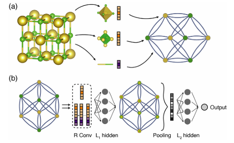
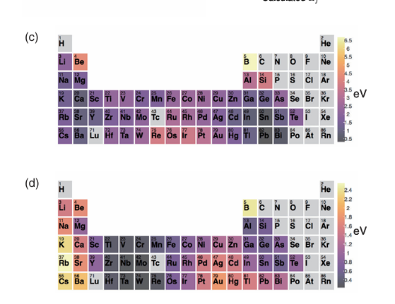

## 相较于 GCNN 的改进

**a. 从数据处理出发**，适应材料科学中的周期性结构（?存疑，文章未说明，需看代码）。主要思想是为每个原子给予一个搜索半径，半径以内的赋予边（仅连接最近的 12 个节点即可获得有效效果）。

**b. 可解释的输出**：最后可以选择后面不使用隐藏层 $L_2$，而是直接使用线性池化输出（文献 12），好处是保证模型的可解释性，可以近似地将每个原子的标量贡献（论文中记为 $\tilde{\mathbf{v}}_{i}$）视为该原子对其局部环境对全局性质的"贡献"。这使得能够解析出晶体中不同原子位点对总体预测性质的贡献。

**c. 边的构造**：边不唯一，可能是双边可能是单边，用边表示两个原子的相互作用强度，因此可能会出现现实中这两个原子没有真正化学键的情况。边的特征通过高斯距离扩展，具体方法是设置不同距离地标，让两原子的距离得到与地标的相似度，从而将距离转化为一系列离散的相似度。

**d. 对于卷积层的改进**：
$$
\boldsymbol{v}_{i}^{(t+1)}=g\left[\left(\sum_{j,k}\boldsymbol{v}_{j}^{(t)}\oplus\boldsymbol{u}_{(i,j)_{k}}\right)\boldsymbol{W}_{c}^{(t)}+\boldsymbol{v}_{i}^{(t)}\boldsymbol{W}_{s}^{(t)}+\boldsymbol{b}^{(t)}\right]
$$
改为
$$
\boldsymbol{v}_{i}^{(t+1)}=\boldsymbol{v}_{i}^{(t)}+\sum_{j,k}\sigma\left(\boldsymbol{z}_{(i,j)_{k}}^{(t)}\boldsymbol{W}_{f}^{(t)}+\boldsymbol{b}_{f}^{(t)}\right)\odot g\left(\boldsymbol{z}_{(i,j)_{k}}^{(t)}\boldsymbol{W}_{s}^{(t)}+\boldsymbol{b}_{s}^{(t)}\right)
$$
其中 $\odot$ 为点积，$g$ 为激活函数。

**Softplus 激活函数**：$f(x) = \ln(1 + \exp(x))$，这个函数在 $x > 0$ 时接近线性增长，而在 $x < 0$ 时则缓慢增加，这样可以避免像 ReLU 那样的"死亡神经元"问题，因为它的导数始终大于零，这意味着即使在输入为负值时，神经元的权重也会在反向传播过程中更新。

## CGCNN 结构

晶体结构 → graph → R 层卷积 → $L_1$ 全连接 → pooling（平均）→ $L_2$ 全连接 → 输出层。

- 对于预测任务，使用全连接输出预测值；对于分类任务，输出层使用 softmax；
- 因此 loss 分别可用方差和交叉熵。

## 实验

文中的实验主要分为三部分：一部分是性能预测，一部分是金属和半导体的分类，一部分是可解释性的应用。

- **预测实验**主要是材料的各种能量指标与 DFT（密度泛函）比较；
- **分类**总准确率为 0.9；
- **可解释性**：用 pooling 经过线性变换直接输出，可以看出不同特征对于输出的权重，同理，也可以知道不同原子经过权重映射后的"得分"：
$$
\hat{y}=\mathbf{w}^T\cdot\mathbf{v}_c+b=\mathbf{w}^T\cdot\left(\frac{1}{N}\sum_{t=1}^N\tilde{\mathbf{v}}_t\right)+b=\frac{1}{N}\sum_{t=1}^N\tilde{v}_t
$$

文中钙钛矿例子中，预测的目标是晶体的"总能量"。通过线性池化，他们将总能量分解到了晶格中的每一个位点（A 位、B 位、X 位）上，通过统计不同元素占据某个位点（如 A 位）时的平均贡献（即 site energy），他们可以画出像图 3(c)(d) 那样的周期表着色图，从而发现经验规律以及缩小筛选范围。

- **A 位**：需要大半径原子（如碱金属、碱土金属），贡献更稳定（更低）的能量。
- **B 位**：过渡金属（特别是 4–6 族）因 d 电子在八面体场中的稳定化作用，贡献更低的能量。

这些从数据中学习到的"规律"与传统的化学知识（如晶体场理论）高度一致，并且还能发现新的规律（如 13–15 族的某些大原子在 A 位也稳定），从而极大地缩小了高通量筛选的范围。
