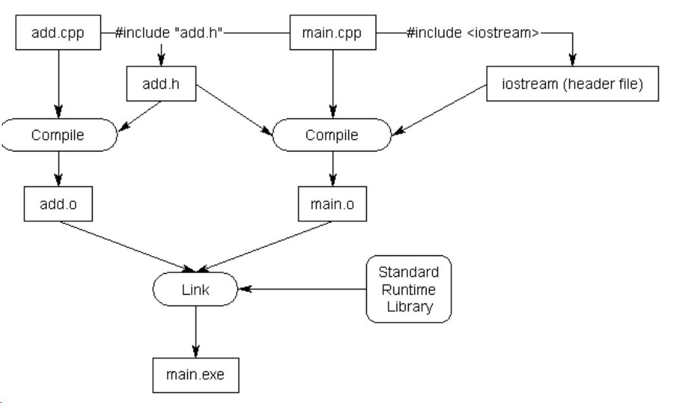

今天读的是预处理器和头文件。大部分内容是 learncpp 的整理，**加粗的是我自己的理解/补充**；中间那张图是分离编译的流程。

## 一、完整笔记

### 1. 不要滥用 `using namespace std;`

避免在程序顶部或头文件里写 `using namespace std;`。这会违背命名空间的初衷：`std` 里的所有名字都会被倒进全局作用域。

**我的理解：如果你在全局作用域定义一个叫 `std` 的变量或函数，会和命名空间 `std` 撞名；在头文件里写 `using namespace std;`，还会把这个风险带给所有包含它的文件。**

在 `.cpp` 里也尽量少用；非要用，就限制在很小的作用域，或者只写 `using std::cout;` 这种精确引入。头文件里一律写 `std::`。

### 2. `#include` 是文本替换

预处理器遇到 `#include <iostream>` 时，会把这一行替换成名为 `iostream` 的文件内容，然后继续处理后面的代码。

所以头文件里的声明、宏、类型定义，都会在 `#include` 的位置被“复制”到当前文件。理解这一点，后面很多现象就顺了。

### 3. 宏定义

`#define` 用来创建宏。宏不是变量，而是一条文本替换规则：预处理时把输入文本换成输出文本。

```cpp
#include <iostream>

#define MY_NAME "Alex"

int main()
{
    std::cout << "My name is: " << MY_NAME << '\n';
    return 0;
}
```

宏名通常全部大写，单词之间用下划线分隔，例如 `MY_NAME`。除非没有更好的替代方案，否则尽量避免使用带替换文本的宏；常量用 `constexpr`，小函数用 `inline` 函数或模板。

### 4. 条件编译

`#ifdef` 检查某个标识符是否已经被 `#define` 定义；`#ifndef` 检查它是否尚未定义。

```cpp
#define PRINT_JOE

int main()
{
#ifdef PRINT_JOE
    std::cout << "Joe\n"; // 会编译，因为 PRINT_JOE 已定义
#endif

#ifndef PRINT_BOB
    std::cout << "Bob\n"; // 会编译，因为 PRINT_BOB 未定义
#endif

    return 0;
}
```

也可以写成更 C++ 风格的 `#if defined(PRINT_BOB)` 和 `#if !defined(PRINT_BOB)`，效果一样。

另一个常见用法是用 `#if 0` 排除一段代码，相当于“注释掉”一个代码块；把它改成 `#if 1` 就能恢复：

```cpp
#if 0 // 从这里开始不编译
    std::cout << "Bob\n";
    std::cout << "Steve\n";
#endif // 到这里结束
```

**记法：是 `#endif`，不是 `#endef`，`endif` = “End If”。**

`#if 0` 的好处是里面可以放心写多行注释，不会像 `/* ... */` 那样被嵌套注释截断。

### 5. 宏的作用域

预处理器不理解 C++ 的函数、花括号、作用域，它只是按文件从上到下逐行处理。

```cpp
void foo()
{
#define MY_NAME "Alex"
}

int main()
{
    std::cout << "My name is: " << MY_NAME << '\n';
    return 0;
}
```

虽然 `#define` 看起来写在函数 `foo` 里面，但预处理器不管这些；从这一行开始，到文件末尾，`MY_NAME` 都被替换成 `"Alex"`。

**我的理解：宏是“文件级”的，预处理时从上到下替换；它不遵守 C++ 的函数/块作用域，写在函数里也一样，但它不会自动跨文件。**

宏可以通过 `#include` 从一个文件复制到另一个文件。例如 `Alex.h` 里写 `#define MY_NAME "Alex"`，`main.cpp` 里 `#include "Alex.h"`，宏就被复制过来了：**这个例子能编译，是因为 `#include` 把宏一起复制过来了。**

但一个文件里的 `#define` 不会自动影响另一个 `.cpp`：

```cpp
// function.cpp
void doSomething()
{
#ifdef PRINT
    std::cout << "Printing!\n";
#endif
#ifndef PRINT
    std::cout << "Not printing!\n";
#endif
}
```

```cpp
// main.cpp
void doSomething();
#define PRINT
int main()
{
    doSomething();
    return 0;
}
```

**我的理解：这个例子不会按 `main.cpp` 里的 `PRINT` 去编译 `function.cpp`。`#define PRINT` 只存在于 `main.cpp`；`function.cpp` 是另一个翻译单元，看不到这个宏。**

宏的作用范围到文件末尾结束；想提前结束可以用 `#undef`。

### 6. 头文件与分离编译

头文件（`.h`）用来集中放声明，然后在需要的地方 `#include`。这样多文件程序不用到处重复写声明。

如果一个头文件和一个代码文件配对，比如 `add.h` 和 `add.cpp`，它们应该使用相同的基本名字 `add`。

```cpp
// add.h
#ifndef ADD_H
#define ADD_H

int add(int x, int y); // 函数声明

#endif
```

```cpp
// add.cpp
#include "add.h" // .cpp 也包含自己的头文件

int add(int x, int y)
{
    return x + y;
}
```

```cpp
// main.cpp
#include "add.h"
#include <iostream>

int main()
{
    std::cout << add(3, 4) << '\n';
    return 0;
}
```

**我的整理：`xx.cpp` 写实现，`xx.h` 放声明，`main.cpp` 用 `#include "xx.h"`。注意是双引号；`xx.cpp` 自己也要 `#include "xx.h"`，这样编译器能检查声明和定义是否对得上。如果 `.cpp` 不包含自己的头文件，编译器可能把两边当成两个不相关的函数，直到链接阶段才报错。**



C++ 是分离编译的：编译和链接是两个步骤。编译器先把 `main.cpp`、`add.cpp` 分别编译成 `main.o`、`add.o`；编译 `main.cpp` 时，它通过 `add.h` 知道“有个 `add` 函数，但先不管实现”。链接器再把 `main.o` 里的调用和 `add.o` 里的定义接起来，最后生成可执行文件。

**我的理解：头文件只是让每个 `.cpp` 知道声明，链接器负责把定义接起来；所以“编译通过”不等于“链接通过”。**

### 7. 不要把头文件当成实现文件

应该避免在头文件里定义函数或变量。头文件被多个 `.cpp` 包含时，很容易违反 ODR。

（目前）记住：**不要在头文件里定义函数和变量。**

如果在头文件里定义了函数，并且这个头文件被多个 `.cpp` 包含，每个翻译单元都会得到一份定义，链接时可能报 multiple definition。

也不要用 `#include` 去包含 `.cpp` 文件。

### 8. 尖括号与双引号

- `#include <iostream>`：尖括号表示这是你自己没写的头文件，预处理器只会在 include directories 指定的目录里查找；
- `#include "add.h"`：双引号表示这是你写的头文件，预处理器会先在当前目录查找。

使用双引号包含自己写的、或预期在当前目录的头文件；使用尖括号包含编译器、操作系统或安装在系统其他位置的第三方库头文件。

标准库头文件不要加 `.h` 后缀；用户自定义头文件仍然用 `.h`。

不要把相对路径硬写进 `#include`（比如 `#include "../include/add.h"`），更好的做法是在 IDE/编译器的 include 路径里配置搜索目录。

### 9. 头文件保护（include guard）

同一个文件里重复定义变量会导致编译错误：

```cpp
int main()
{
    int x;
    int x; // compile error: duplicate definition
    return 0;
}
```

头文件更容易出现这种问题：一个头文件 `#include` 了另一个头文件，`main.cpp` 又把两个都包含了，就可能重复定义。

头文件保护的形式：

```cpp
#ifndef SOME_UNIQUE_NAME_HERE
#define SOME_UNIQUE_NAME_HERE

// 声明（以及某些允许的定义）

#endif
```

命名惯例是用头文件的完整文件名，全部大写，空格或标点用下划线，例如 `square.h` 用 `SQUARE_H`。

```cpp
// square.h
#ifndef SQUARE_H
#define SQUARE_H

int getSquareSides()
{
    return 4;
}

#endif
```

```cpp
// wave.h
#ifndef WAVE_H
#define WAVE_H

#include "square.h"

#endif
```

```cpp
// main.cpp
#include "square.h"
#include "wave.h"

int main()
{
    return 0;
}
```

预处理器第一次处理 `square.h` 时，`SQUARE_H` 还没定义，于是包含里面的代码，并定义 `SQUARE_H`。第二次再遇到 `square.h` 时，`SQUARE_H` 已经定义，整段代码被跳过，避免了同一翻译单元里的重复定义。

**我的理解：这个例子很关键。`square.h` 里直接定义了 `getSquareSides()`，而 `square.cpp` 和 `main.cpp` 都包含了它。包含保护只能防止同一个 `.cpp` 里重复包含，不能防止两个 `.cpp` 各拿到一份定义，所以链接时还是会重复定义。头文件里应该只放声明。**

现代编译器支持 `#pragma once`，写起来更简单：

```cpp
#pragma once
// your code here
```

它和 include guard 的目的相同，但 `#pragma once` 不是标准 C++，只是被主流编译器广泛支持。跨平台项目里，include guard 更稳。

## 二、易错点

### `#define` 是文本替换，不是变量

```cpp
#define SQUARE(x) x * x
int y = SQUARE(1 + 2);
```

展开后是 `1 + 2 * 1 + 2`，结果是 5，不是 9。正确写法是给参数和整体都加括号：

```cpp
#define SQUARE(x) ((x) * (x))
```

宏没有类型检查，也不遵守作用域，调试时看到的代码和展开后的代码可能完全不一样。常量优先用 `constexpr`，小函数优先用 `inline` 函数或模板；宏主要留给 include guard、条件编译这类预处理场景。

### 宏不遵守 C++ 作用域，但也不会跨文件

```cpp
void foo()
{
#define MY_NAME "Alex"
}

int main()
{
    std::cout << MY_NAME << '\n'; // 能编译
}
```

`#define` 写在函数里，预处理器也不管；从那一行到文件末尾，宏都有效。但它不会跑到另一个 `.cpp` 里，除非那个文件自己 `#define`，或者通过 `#include` 把头文件里的宏复制过去。

写宏时尽量放在文件顶部，用完 `#undef`；不要依赖“另一个文件里定义过”的假设。

### 头文件里定义函数/变量会导致重复定义

```cpp
// square.h
int getSquareSides() { return 4; }
```

`a.cpp` 和 `b.cpp` 都 `#include "square.h"`，两个翻译单元各有一份 `getSquareSides` 的定义。编译能过，链接时报 multiple definition。

头文件只放声明；函数定义放 `.cpp`。类型、模板、内联函数/变量是例外，但也要遵守相应规则。

### 包含保护只防“同一翻译单元重复包含”

include guard 的 `SQUARE_H` 是每个翻译单元各自的一份宏。`square.cpp` 包含 `square.h` 时定义了 `SQUARE_H`，但 `main.cpp` 是新的翻译单元，`SQUARE_H` 又是未定义的，于是它也会再包含一次。

所以：

- 包含保护能防止同一个 `.cpp` 里重复包含同一个头文件；
- 它不能防止两个 `.cpp` 各包含一次头文件；
- 如果头文件里放了函数/变量的定义，两个 `.cpp` 照样会各有一份定义，链接时还是 ODR 问题。

结论还是那句：头文件只放声明。

### 尖括号和双引号不是随便选的

```cpp
#include <iostream> // 系统/标准库，去 include 目录找
#include "add.h"    // 自己的头文件，先找当前目录
```

标准库头文件不加 `.h`；自己写的头文件用 `.h`。不要把相对路径硬写进 include，改用编译器的 include 路径。

### `.cpp` 也要包含自己的头文件

`add.cpp` 定义了 `add`，但它也应该 `#include "add.h"`。这样编译器能检查声明和定义是否一致；如果声明是 `int add(int, int)`，定义却写成 `double add(double, double)`，编译阶段就能发现。

不包含的话，编译器可能把两边当成两个不相关的函数，悄悄放行，直到链接阶段才报错，或者留下很难查的 bug。

### `using namespace std;` 放在头文件会污染所有包含者

头文件里写 `using namespace std;`，所有包含它的 `.cpp` 都会把 `std` 里的名字倒进全局作用域。你自己的 `count`、`distance`、`data` 可能和标准库撞名；你在全局定义 `std` 还会和命名空间 `std` 冲突。

头文件里一律写 `std::`；`.cpp` 里也尽量用精确的 `using std::cout;`，而不是整个命名空间。

## 速查表

| 想做的事 | 写法 |
| --- | --- |
| 包含自己的头文件 | `#include "add.h"` |
| 包含标准库 | `#include <iostream>` |
| 防止头文件重复包含 | `#ifndef` / `#define` / `#endif` |
| 简化包含保护 | `#pragma once` |
| 条件编译 | `#ifdef` / `#ifndef` / `#if 0` |
| 取消宏 | `#undef NAME` |
| 头文件里放什么 | 只放声明，不放函数/变量定义 |

## 参考

- [learncpp: Preprocessor](https://www.learncpp.com/cpp-tutorial/introduction-to-the-preprocessor/)
- [learncpp: Header files](https://www.learncpp.com/cpp-tutorial/header-files/)
- [learncpp: Header guards](https://www.learncpp.com/cpp-tutorial/header-guards/)
