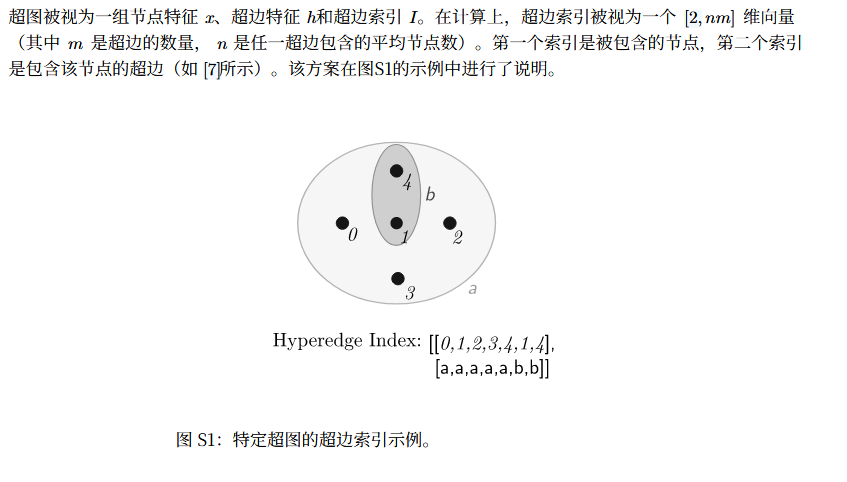
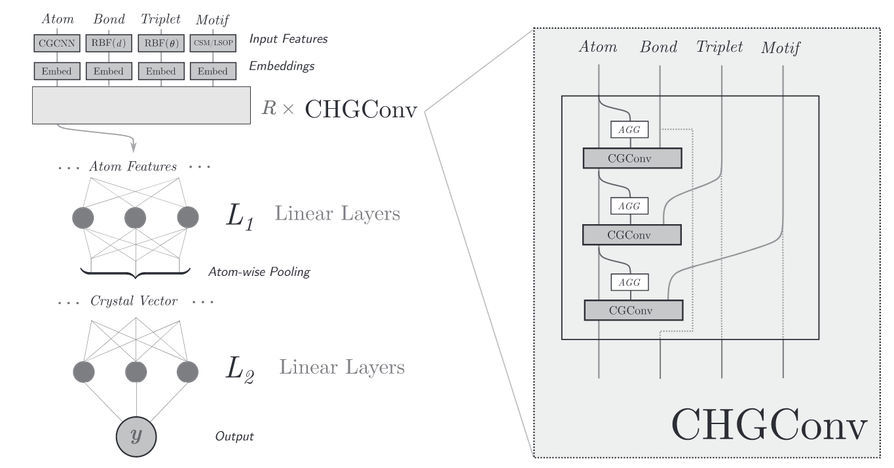

## 超图引索

## 超图特征

为什么需要超图：常规构造里面（比如 CGCNN）缺乏几何信息，同样原子数量的晶体可能会构成不同的几何结构。

文中构造了三种超图特征，进行使用和对比：**Bond**、**Triplet**、**Motif**（创新点，主推）。

- **Bond Hyperedges（传统边）**：基于距离截断。在半径 $r_{max}=8$ Å 内寻找最近的 $N_{max}=12$ 个邻居。特征内容：原子间距离的高斯展开（RBF），维度为 40，范围 0–8 Å。物理意义是编码原子间的径向分布。
- **Triplet Hyperedges（三体超边）**：由共享同一个中心原子的两条边组成（即 $A-B$ 和 $A-C$ 形成一个三体关系）。特征内容：键角的余弦值（$\cos \theta$）的高斯展开，维度同样为 40（解决区分几何结构问题）。**一个原子有 $N$ 条键，它将产生 $N(N-1)/2$ 个三体超边。**
- **Motif Hyperedges（模体超边）**：基于 Voronoi 算法（具体使用了 pymatgen 的 CrystalNN）确定的第一配位层原子集合。这就形成了一个包含中心原子及其所有第一近邻的"超边"。特征内容：59 个连续对称性度量（Continuous Symmetry Measures, CSMs）。每个原子对应且仅对应 1 个模体超边。

插叙：

- CSM 是一种定量计算某个几何结构与特定对称群（如正四面体 $T_d$、正八面体 $O_h$）之间偏差程度的方法。如果是完美的正八面体，那么对"八面体"的 CSM $\approx 0$，对"四面体"的 CSM $\approx 30$（很大）。文中这 59 个值里通常只有 1 个接近 0，其他都很大。这非常像分类任务中的 One-hot 编码。
- LSOP（局部结构序参数）也是用来判断与标准模型的相似度，在本文中，效果不如 CSM（补充材料 S8 中，MAE(CSMs) < MAE(both) < MAE(LSOP)）。

## 更新函数

参考了信息传递过程：

$$
m_{v}^{t+1} = \sum_{h_{j}\in \mathcal{N}(v)}  M_{t}(n_{v}^{t}, h_{j}^{t}, \{n_{w}^{t}|n_{w} \in h_{j}\})
$$

$$
n_{v}^{t+1} = U_{t}(n_{v}^{t}, m_{v}^{t+1})
$$

$$
\hat{y} = R(\{n_{v}^{T}\})
$$

文中构想了三种不同的超边消息传递函数 $M_t$：

1. **Relatives Dual Graph**

   $$
   m_{v}^{t+1} = \sum_{h_{j}\in \mathcal{N}(v)}  M_{t}(v \oplus h_{j})
   $$

   中心节点 $v$ 只与超边 $h$ 本身的特征进行交互，忽略了超边内部其他邻居节点 $v_j$ 的特征。复杂度 $\mathcal{O}(n)$。

2. **Total Exchange**

   $$
   m_{v}^{t+1} = \sum_{h_{j}\in \mathcal{N}(v)} \sum_{v_j \in h} M_{t+1}(v \oplus h_{j} \oplus v_j)
   $$

   超边内的每一个节点都与其他所有节点进行两两交互。复杂度 $\mathcal{O}(n^2m)$。

3. **Neighborhood Aggregation（主推）**

   $$
   m_{v}^{t+1} = \sum_{h_{j}\in \mathcal{N}(v)}  M_{t+1}(v \oplus h_{j} \oplus \text{AGG}(\{v_j \in h_{j}\}))
   $$

   先把所有邻居节点 $\{v_j\}$ 的特征通过一个聚合函数压缩成一个向量，然后再与中心节点 $v$ 和超边 $h$ 交互。复杂度 $\mathcal{O}(nm)$，节省开销。

   $$
   \text{AGG} = \text{Concat} ( \alpha_1 \cdot \text{Max}, \ \alpha_2 \cdot \text{Min}, \ \alpha_3 \cdot \text{Mean}, \ \alpha_4 \cdot \text{Std} )
   $$

   - $h_j$（超边特征）：之前构造的几何特征（如键长高斯值、键角余弦值、或模体的 CSM 对称性度量）；
   - AGG 函数：邻居节点特征矩阵（假设有 $N$ 个邻居，每个特征维度为 $D$）$M_{N \times D}$ 按行求最大、最小、均值、标准差，得到 4 个 D 维向量，学习各自权重后拼接。

具体来说，各个传递之后，$M_t$ 是做一个 MLP；$n_{v}^{t+1} = U_{t}(n_{v}^{t}, m_{v}^{t+1})$ 对应 $n_{new} = n_{old} + m_t$；$\hat{y} = R(\{n_{v}^{T}\})$ 对应 $v_{crystal} = \frac{1}{N_{atoms}} \sum_{i=1}^{N_{atoms}} n_i^{final}$。

## 分层顺序更新

在每一个卷积层（CHGConv Layer）内部，模型按阶数从小到大依次更新原子特征：

- **Bond Update**：首先利用键超边（距离信息）更新原子向量；
- **Triplet Update**：接着利用三体超边（角度信息）修正原子向量；
- **Motif Update**：最后利用模体超边（局部配位几何信息）再次修正原子向量。

这种串行结构（例如：Bond → Motif → Bond）确保了原子表征能逐步融合从低阶（距离）到高阶（形状）的几何约束。

## 实验结果

主要是自己构造的三个超图特征对比，Bond-only 其实就是 CGCNN。在测试的绝大多数性质中，引入高阶几何信息（无论是 Motif 还是 Triplet）都比仅使用距离的 Bond-only（CGCNN）模型效果好；Bond & Motif 模型在性能上通常与 Bond & Triplet 模型持平或更好，但在计算成本（消息传递数量）上却低了 1–2 个数量级。

数据量较小（1k–2w 样本）的任务上，几何信息的引入带来了显著提升。

大数据集上，比较特征有：能带隙（$E_g$）、金属性分类、形成能（$E_f$）。**注意：形成能（$E_f$）不吃几何信息，主要由化学键的强弱（原子间距离）决定；电子性质（如能带结构）高度依赖于局部的配位环境。**
