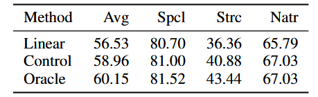
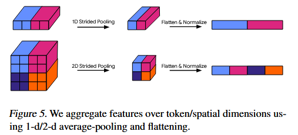

## 术语

- **Scratch**：从头训练
- **Fine-tuning**：微调
- **Linear Probing**：只训练最后一层
- **OOD (Out-of-Distribution)**：源数据与训练数据分布差别很大

## 问题

做预训练的时候，要么"冻结参数只训最后一层"（Linear Probing，省钱但效果差），要么"微调整个模型"（Fine-tuning，效果好但太贵、太占存储）。特别是在目标任务和预训练任务分布差别非常大时，Linear Probing 效果特别差。

## 解决

提出 **Head2Toe**：认为不用微调整个大模型，只要把模型所有中间层的特征都拿出来，筛选出最有用的拼在一起，只训练一个新的分类头，就能达到甚至超过全量微调的效果。

从两个方面验证这么想是对的：

1. **理论**：用泰勒展开证明 Fine-tuning 本质上就是对中间层特征的一种线性组合利用。
2. **实验**：linear（只用 1 个 ResNet 的最后一层）、control（用了 2 个预训练 ResNet（不同随机种子）的最后一层拼在一起——注意：它的特征维度翻倍了，和 Oracle 一样大，但是没有用中间层）、Oracle（用了 1 个 ResNet 的最后一层 + 1 个最佳中间层）三者比较。

## 做法

冻结 → 提取全部特征 → 筛选主要特征训练 → 重新使用。

### 冻结

$1 \sim L-2$ 层不动，去掉 $L-1$ 层，重新训练 $z_L=h_{L-1}W_L$，其中 $h_{L-1}$ 为所有层特征处理后的特征，$W_L$ 为新训练的权重。即 $z_L=h_{all}W_{all}$。

### 提取全部特征

pooling（平均池化，且选择不重叠）→ flatten → 标准化 → 拼接成 $h_{all}$。

### 筛选主要特征训练

训练 $W_{all}$。训练时，损失函数里加了一个特殊的正则项：**Group Lasso**

$$
\boldsymbol{W}_{2,1} = |\boldsymbol{s}|_1 = \sum_i |s_i| \quad ; \quad s_i = \sqrt{\sum_j w_{ij}^2}
$$

因为 $z_L=h_{all}W_{all}$，$W$ 的每一行代表的是第 $i$ 个特征处理不同问题下的权重。文中举的是分类问题：通过 2 范数将对分类的所有贡献捆绑在一起，然后通过 1 范数用梯度下降评估整体的贡献，这样就可以把对所有问题都特别有用的特征提取出来。

训练完后，计算每个特征对应权重的 $l_2$ 范数，作为一个"重要性分数" $s_i$。分数越高，说明这个特征越重要。通过调整超参 F，只保留分数最高的前 F% 的特征。

### 重新使用

只用这精选出来的 F% 特征，重新初始化进行训练。这次训练不再加 Group Lasso 正则化了。

**F 的选择**：作者对每个任务单独进行交叉验证（Cross-validation）来选择最佳的 F 值。

## 备注

- ps：$loss+\lambda w$ 梯度下降时，偏导始终含常数，因此权重是可能降到 0 的；而 $loss+\lambda w^2$ 中权重是不会降到 0 的。
- 看似繁琐，但因为始终只训练一层，所以即使向量再大，也会比多层训练的微调或者从头训练快得多。
