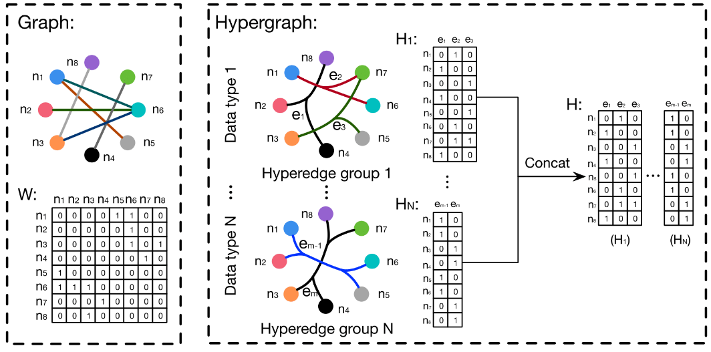

亮点：超图卷积公式，k 近邻确定超边（可用于多模态数据的超图构建）。

## 超图构建

如果第 $i$ 个节点在第 $j$ 条超边里，则 $H_{ij}=1$。

## k 近邻确定超边

1 个中心节点和它的 $K$ 个邻居（共 $K+1$ 个节点）打包，定义为一条超边。

**可用于多模态数据的超图构建**：有两套特征（比如晶体的几何坐标特征 $F_{geo}$ 和化学属性特征 $F_{chem}$）。用 $F_{geo}$ 算一次 KNN，生成一组超边 $H_{geo}$；用 $F_{chem}$ 算一次 KNN，生成另一组超边 $H_{chem}$。最后将两个矩阵拼在一起 $H = [H_{geo}, H_{chem}]$。

## 超边卷积

文章和传统 GCN 一样，用了切比雪夫多项式近似，以及一阶近似：

$$
Y = D_v^{-1/2}\, H\, W\, D_e^{-1}\, H^T\, D_v^{-1/2}\, X\, \Theta
$$

- $X$（Input Node Features）：输入的节点特征矩阵，维度为 $N \times C_1$。$N$ 是节点（原子）数量，$C_1$ 是输入的特征维度。
- $\Theta$（Learnable Parameters）：神经网络的可学习权重矩阵（Filter），维度为 $C_1 \times C_2$。
- $H$（Incidence Matrix / 关联矩阵）：超图的关联矩阵，维度为 $N \times E$。
- $W$（Hyperedge Weights / 超边权重）：超边权重的对角矩阵，维度为 $E \times E$。它允许模型给某些特定的原子组合赋予更高的权重。
- $D_e$（Hyperedge Degree Matrix）：超边度的对角矩阵。计算：一条超边里包含多少个节点。
- $D_v$（Vertex Degree Matrix）：节点度的对角矩阵。计算：一个节点参与了多少条超边（还要乘以超边权重）。

**它的计算复杂度是 $\mathcal{O}(|E|)$**（通常 $N$（节点数）和 $|E|$（边数）是同阶的），**从右往左做矩阵乘法，能保证稀疏矩阵**。
