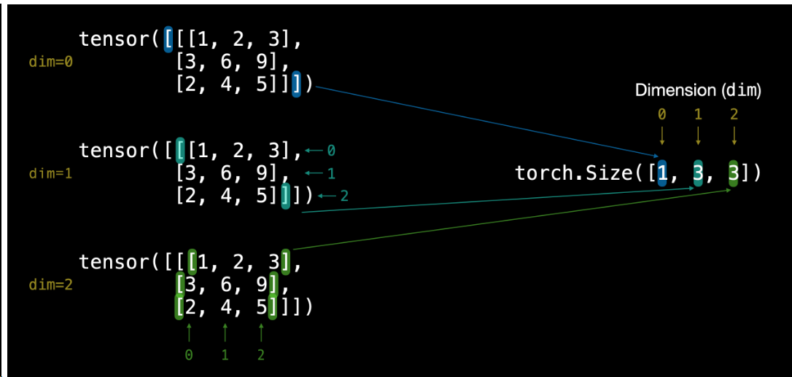

今天花十分钟读了 [torch.Tensor 的官方文档](https://docs.pytorch.org/docs/2.14/tensors.html)，把张量最基础的几个概念过了一遍：维度、形状、取值、创建、类型、运算。后面做了 9 道自测题，按「题目 → 错点 → 解析」记录，方便之后只看题目复习。

## 一、学习笔记

### 1. ndim：维度就是嵌套层数

`xx.ndim` 返回张量的维度，也就是嵌套了几层括号，等于 `len(xx.shape)`。`shape` 里的每个数字表示该层有几个元素。

| 写法 | ndim | shape |
| --- | --- | --- |
| `torch.tensor(7)` | 0 | `torch.Size([])` |
| `torch.tensor([7])` | 1 | `torch.Size([1])` |
| `torch.tensor([1, 2])` | 1 | `torch.Size([2])` |
| `torch.tensor([[7]])` | 2 | `torch.Size([1, 1])` |

> [!NOTE]
> 零维张量的 shape 是空列表 `torch.Size([])`，不是数字 0；判断零维用 `x.ndim == 0`。

### 2. item()：取出单个 Python 数

`xx.item()` 把只含一个元素的张量取成 Python 数值。限制是元素个数必须正好 1 个，即 `xx.numel() == 1`，与维度无关。

```python
torch.tensor([[7]]).item()      # 7
torch.tensor([1, 2, 3]).item()  # RuntimeError
```

所以 `torch.tensor([[7]])` 虽然是二维，也能 `.item()`。

### 3. shape：元素是怎么排列的

数法：最外层有几个块 → 第一个数；每个块里有几行 → 第二个数；每行有几个数 → 第三个数。

```python
TENSOR = torch.tensor([
    [[1, 2, 3, 4],
     [3, 6, 9, 4],
     [2, 4, 5, 4]],
    [[1, 2, 3, 4],
     [3, 6, 9, 4],
     [2, 4, 5, 4]],
])
```

最外层有 2 个块，每个块有 3 行，每行有 4 个数，所以 `TENSOR.shape` 是 `torch.Size([2, 3, 4])`。



图 1 用的是形状为 `(1, 3, 3)` 的例子：最外层括号是 `dim=0`，往里依次是 `dim=1`、`dim=2`；最外层只有 1 个块，所以 shape 的第一个数是 1。

元素总数 = shape 各维相乘，也可以直接 `t.numel()`。上面的 `TENSOR.numel()` 是 `2 * 3 * 4 = 24`。

### 4. 创建张量

```python
torch.rand(3, 4)        # 3x4 的 0-1 随机矩阵
torch.zeros(3, 4)       # 全 0
torch.ones(3, 4)        # 全 1
torch.arange(0, 10, 1)  # 0 到 9，end 是开区间

x = torch.rand(3, 4)
torch.zeros_like(x)     # 形状同 x，全 0
torch.ones_like(x)      # 形状同 x，全 1
```

`torch.rand(3, 4)` 也可以写成 `torch.rand((3, 4))`。

### 5. dtype 与 device

创建时用 `dtype=torch.float32` 指定类型：

```python
float_16_tensor = torch.tensor([3.0, 6.0, 9.0], dtype=torch.float16)
# torch.half 也可以

xx.dtype          # 查询数据类型
xx.device         # 查询储存的设备位置（CPU / CUDA）

xx.type(torch.float32)
xx.float()
xx.to(torch.float32)
```

`torch.arange(1, 5)` 默认是 `torch.int64`；`torch.arange(1., 5)` 因为给了浮点参数，结果是 `float32`。

> [!WARNING]
> `dtype` 是属性，不是函数，不能写 `xx.dtype(torch.float32)`；改类型用 `.type()`、`.float()` 或 `.to()`。

### 6. 张量运算与矩阵乘法

逐元素运算直接用 `+ - * /`；`torch.mul()` 和 `torch.multiply()` 是同一个函数，都是逐元素乘；`torch.add()` 是加法。

```python
a = torch.rand(3, 4)
a = a + 10
torch.multiply(a, 10)  # 等价于 a * 10
torch.add(a, 10)
```

矩阵乘法用 `@`，它是 `torch.matmul()` 的简写，要求 `(m, k) @ (k, n) -> (m, n)`，内维必须相等。

```python
a = torch.rand(3, 4)
a @ a      # 报错：(3,4) @ (3,4)，内维 4 vs 3 不相等
a @ a.T    # (3, 3)
a @ a.mT   # (3, 3)
```

`torch.mm()` 不是 `matmul` 的简写：它只接受二维矩阵；`torch.bmm()` 只接受三维批量矩阵。高维时 `matmul` 把前面几维当 batch：`(2,3,4) @ (2,4,5) -> (2,3,5)`。

| 写法 | 接受维度 | 行为 |
| --- | --- | --- |
| `torch.mm` | 仅二维 | 矩阵乘 |
| `torch.matmul` / `@` | 通用，高维按 batch | 最后两维做矩阵乘 |
| `torch.bmm` | 仅三维 | 批量矩阵乘 |

`*` 是逐元素乘法，两边 shape 要相同或可广播；`@` 才是矩阵乘法。

### 7. 转置

`torch.transpose(input, dim0, dim1)` 只交换指定的两个维度，其余不变。

```python
x = torch.rand(2, 3, 4)
x.transpose(0, 1)  # (3, 2, 4)
x.transpose(0, 2)  # (4, 3, 2)
```

`tensor.T` 把所有维度整体倒序：`(2,3,4) -> (4,3,2)`。但三维及以上已经弃用，会出 `UserWarning`，将来会直接报错。

`Tensor.mT` 只置换最后两个维度，等价于 `x.transpose(-2, -1)`：`(2,3,4) -> (2,4,3)`。

> [!TIP]
> 高维转置优先用 `.mT` 或 `torch.transpose`，不要用 `.T`。三维时 `.T` 和 `transpose(0, 2)` 结果相同只是巧合，`.T` 的规则是整体倒序。

### 8. 拼接：torch.cat

```python
x = torch.randn(3, 2)
y = torch.zeros(3, 1)

torch.cat((x, y), dim=1)  # (3, 3)
torch.cat((x, y), dim=0)  # 报错
```

规则：沿哪个 `dim` 拼，那一维可以不等长，其余维度必须完全一致。`dim=1` 拼列，x 有 2 列、y 有 1 列，拼成 3 列；`dim=0` 拼行时要求列数相同，2 vs 1 不一致，所以报错。

```text
RuntimeError: Sizes of tensors must match except in dimension 0.
Expected size 2 but got size 1 ...
```

### 9. 聚合与 argmax

`xx.min()`、`xx.max()`、`xx.mean()`、`xx.sum()` 不加参数就是对所有元素聚合。

`mean` 只能在浮点（或复数）张量上调用，整数会报错；`torch.arange` 默认是 `int64`。

```python
x = torch.arange(1, 5)
x.mean()
# RuntimeError: mean(): could not infer output dtype ...
# Got: Long

x.float().mean()             # tensor(2.5000)
x.type(torch.float32).mean() # tensor(2.5000)
x.to(torch.float32).mean()   # tensor(2.5000)
```

`sum` 要加括号：`xx.sum()`，不是 `xx.sum`；`torch.sum(xx)` 等价。

`torch.argmax()` / `torch.argmin()` 返回最大值 / 最小值的位置索引：

- 不写 `dim`：把整个张量拉平，返回全局索引；
- 写 `dim=k`：沿第 k 维找最大值，返回该维上的索引；输出 shape = 原 shape 去掉第 k 维；
- 返回的是索引，不是值；要同时拿值用 `xx.max(dim=1)`，返回 `(values, indices)`。

```python
x = torch.tensor([[4, 9, 1],
                  [7, 2, 8]])

torch.argmax(x)         # tensor(1)
torch.argmax(x, dim=0)  # tensor([1, 0, 1])
torch.argmax(x, dim=1)  # tensor([1, 2])
```

- 不写 `dim`：拉平成 `[4, 9, 1, 7, 2, 8]`，最大值 9 在索引 1。
- `dim=0`：逐列比较，返回最大值的行号：`[4,7] -> 1`、`[9,2] -> 0`、`[1,8] -> 1`。
- `dim=1`：逐行比较，返回最大值的列号：`[4,9,1] -> 1`、`[7,2,8] -> 2`。

### dim 参数速查

| 操作 | 含义 | 输出 shape |
| --- | --- | --- |
| `argmax(x, dim=k)` | 沿第 k 维取最大值索引 | 去掉第 k 维 |
| `sum(x, dim=k)` | 沿第 k 维求和 | 默认去掉第 k 维；`keepdim=True` 保留长度为 1 |
| `cat((a, b), dim=k)` | 沿第 k 维拼接 | 其余维度必须相同 |
| `transpose(a, b)` | 交换第 a、b 两维 | 对应维度互换 |
| `matmul` | 最后两维做矩阵乘 | `(..., m, k) @ (..., k, n) -> (..., m, n)` |

## 二、自测题（9 道）

批改结论：Q2、Q7 全对；Q1、Q3、Q4 思路对但细节有错；Q5、Q6、Q8、Q9 属于还没学到的部分。暴露的三个薄弱点是 dtype 规则、dim 参数语义、mm 与 matmul 的区别。复习时先只看题目，自己写一遍，再对照解析。

### Q1｜ndim / shape / item

**题目**

```python
a = torch.tensor(7)
b = torch.tensor([7])
c = torch.tensor([[7]])
print(a.ndim, b.ndim, c.ndim)
print(a.shape, b.shape, c.shape)
```

(1) 两行分别输出什么？
(2) 这三个张量里，哪些能调用 `.item()`？

**错点**

- 后两个 shape 写成了 `(1)`、`(1,1)`；正确是 `torch.Size([1])`、`torch.Size([1, 1])`，零维是 `torch.Size([])`，不是 0。
- 误以为只有 `a`、`b` 能用 `.item()`；实际上 `c` 也能用，判据是 `numel() == 1`，与维度无关。

**解析**

```python
print(a.ndim, b.ndim, c.ndim)   # 0 1 2
print(a.shape, b.shape, c.shape)
# torch.Size([]) torch.Size([1]) torch.Size([1, 1])

a.item(), b.item(), c.item()    # 7 7 7
```

- 零维张量的 shape 是空列表 `torch.Size([])`，判断用 `a.ndim == 0`。
- `(1)` 在 Python 里不是元组，元组要写 `(1,)`；表示 shape 时直接用 `torch.Size([...])`。
- `item()` 的判据是元素个数正好 1 个，即 `numel() == 1`。

### Q2｜数 shape

**题目**

```python
t = torch.tensor([
    [[1, 2, 3], [4, 5, 6]],
    [[7, 8, 9], [10, 11, 12]],
    [[13, 14, 15], [16, 17, 18]],
])
```

`t.shape` 是什么？`t.ndim` 是多少？一共多少个元素？

**作答**

shape `(3,2,3)`、ndim `3` 全对；元素个数没答。

**解析**

`t.shape -> torch.Size([3, 2, 3])`，`t.ndim -> 3`，元素总数 `3 * 2 * 3 = 18`，也可以直接 `t.numel()`。元素总数 = shape 各维相乘。

### Q3｜mean 的 dtype 限制

**题目**

```python
x = torch.arange(1, 5)
print(x.dtype)
print(x.mean())
```

(1) 第二行为什么跑不通？
(2) 给出两种能算出 2.5 的写法。

**错点**

- 原因说对了：`mean` 要浮点，`arange` 默认是 `int64`。
- 写法 2 把 `dtype` 当函数调用，语法错：`x.dtype(torch.float32)` 不合法。

**解析**

```python
torch.arange(1, 5).dtype  # torch.int64

# 写法 1：创建时就给浮点
torch.arange(1., 5).mean()  # tensor(2.5000)

# 写法 2：先转类型
x.type(torch.float32).mean()   # tensor(2.5000)
x.float().mean()               # tensor(2.5000)
x.to(torch.float32).mean()     # tensor(2.5000)
```

报错原文：

```text
RuntimeError: mean(): could not infer output dtype.
Input dtype must be either a floating point or complex dtype. Got: Long
```

`dtype` 是属性，值是 `torch.int64`；改类型用 `.type()` / `.float()` / `.to()`。

### Q4｜* 和 @ 的区别

**题目**

```python
a = torch.rand(2, 3)
```

`a * a`、`a @ a`、`a @ a.T`、`torch.mm(a, a.T)` 的结果 shape 各是什么？`*` 和 `@` 的区别是什么？

**错点**

- `a * a` 没给 shape。
- `*` 和 `@` 的区别没写。
- 其余结论对：`a @ a` 报错；`a @ a.T` 是 `(2,2)`；`torch.mm(a, a.T)` 与 `a @ a.T` 等价。

**解析**

| 表达式 | 结果 |
| --- | --- |
| `a * a` | `torch.Size([2, 3])` |
| `a @ a` | 报错：`(2,3) @ (2,3)`，内维 3 vs 2 不相等 |
| `a @ a.T` | `torch.Size([2, 2])` |
| `torch.mm(a, a.T)` | `torch.Size([2, 2])`，与 `a @ a.T` 等价 |

`*` 逐元素相乘，两边 shape 相同或可广播；`@` 矩阵乘，要求 `(m,k) @ (k,n) -> (m,n)`。

### Q5｜mm 和 matmul

**题目**

```python
x = torch.rand(2, 3, 4)
y = torch.rand(2, 4, 5)
```

`torch.mm(x, y)` 和 `torch.matmul(x, y)` 分别会怎样？为什么？

**错点**

以为 `mm` 和 `matmul` 等价；高维矩阵乘法不了解。

**解析**

```python
torch.mm(x, y)      # RuntimeError: self must be a matrix
torch.matmul(x, y)  # torch.Size([2, 3, 5])
```

`mm` 只接受二维矩阵；`matmul` 是通用版，高维时把前面几维当 batch，逐批做 `(3,4) @ (4,5)`。三维批量还可以用 `torch.bmm`。

### Q6｜T / mT / transpose

**题目**

```python
x = torch.rand(2, 3, 4)
```

`x.T.shape`、`x.mT.shape`、`x.transpose(0, 2).shape` 各是什么？`x.mT` 等价于哪个 `transpose` 写法？三维及以上用 `.T` 会得到什么提示？

**错点**

- `x.T` 和 `x.transpose(0, 2)` 的结果答对了，但把“维度倒过来”误当成所有转置的规则。
- `.mT` 没答。

**解析**

```python
x.T.shape               # torch.Size([4, 3, 2])
x.mT.shape              # torch.Size([2, 4, 3])
x.transpose(0, 2).shape # torch.Size([4, 3, 2])
```

- `.T` 把所有维度整体倒序。
- `.mT` 只交换最后两个维度，等价于 `x.transpose(-2, -1)`。
- `.T` 在三维以上已弃用，会出 `UserWarning`，提示改用 `.mT` 或 `permute`。
- 三维时 `.T` 和 `transpose(0, 2)` 结果相同只是巧合；`transpose(a, b)` 只交换指定两维，例如 `x.transpose(0, 1)` 得到 `(3, 2, 4)`。

### Q7｜cat

**题目**

```python
x = torch.randn(3, 2)
y = torch.zeros(3, 1)
z = torch.cat((x, y), dim=1)
w = torch.cat((x, y), dim=0)
```

`z` 和 `w` 分别是什么？哪个会报错、为什么？

**作答**

全对：`z` 是 `(3, 3)`；`w` 报错。

**解析**

`z -> torch.Size([3, 3])`；`w` 报错：

```text
RuntimeError: Sizes of tensors must match except in dimension 0.
Expected size 2 but got size 1 ...
```

`cat` 沿哪个 `dim` 拼，那一维可以不等长，其余维度必须完全一致。`dim=0` 拼行时要求列数相同，x 有 2 列、y 只有 1 列，所以错。

### Q8｜argmax

**题目**

```python
x = torch.tensor([[4, 9, 1],
                  [7, 2, 8]])
print(torch.argmax(x))
print(torch.argmax(x, dim=0))
print(torch.argmax(x, dim=1))
```

三行各输出什么？不写 `dim` 时返回的是什么索引？

**错点**

新知识点，完全不清楚。

**解析**

```python
torch.argmax(x)         # tensor(1)
torch.argmax(x, dim=0)  # tensor([1, 0, 1])
torch.argmax(x, dim=1)  # tensor([1, 2])
```

- 不写 `dim`：拉平成 `[4, 9, 1, 7, 2, 8]`，最大值 9 在索引 1，返回 `tensor(1)`。
- `dim=0`：逐列比较，返回最大值的行号：`[4,7] -> 1`、`[9,2] -> 0`、`[1,8] -> 1`。
- `dim=1`：逐行比较，返回最大值的列号：`[4,9,1] -> 1`、`[7,2,8] -> 2`。
- 通用规则：`dim=k` 沿第 k 维找最大值，返回该维上的索引；输出 shape = 原 shape 去掉第 k 维。
- 返回的是索引不是值；要同时拿值用 `x.max(dim=1)`，返回 `(values, indices)`。

### Q9｜形状 + dtype + 聚合

**题目**

```python
x = torch.zeros(2, 3)
y = torch.rand(3, 4)
z = x @ y
```

(1) `z.shape`？(2) `z.dtype`？(3) `torch.sum(z)`？(4) `torch.mean(z)` 能直接调用吗？

**错点**

- shape 对：`(2, 4)`。
- dtype 结果对，但理由错：不是“按最小的来”。
- `sum` / `mean` 没答。

**解析**

```python
z.shape       # torch.Size([2, 4])
z.dtype       # torch.float32
torch.sum(z)  # tensor(0.)
torch.mean(z) # tensor(0.)
```

- dtype 不是“按最小的来”：`torch.zeros` / `torch.rand` 默认都是 `float32`，`matmul` 要求两边 dtype 一致，结果跟随这个 dtype；一边 `int64` 一边 `float32` 会直接报错。
- x 是全零矩阵，`x @ y` 的每个元素都是 0 的线性组合，所以全是 0。
- `mean` 能直接调用，因为 z 是 `float32`——正好是 Q3 那条规则的正面例子。

### 本次暴露的三个薄弱点

1. **dtype 规则**：`mean` 只吃浮点；`item()` 的判据是 `numel() == 1`；`dtype` 是属性不是函数；改类型用 `.type()` / `.float()` / `.to()`。
2. **dim 参数语义**：`argmax` / `sum` / `mean` / `cat` / `transpose` 都有 `dim`，含义都是“沿哪一维操作”，但输出 shape 的变化各不相同。
3. **mm / matmul / bmm**：二维专用 / 通用（高维按 batch）/ 三维专用。

复习方法：先只看题目，自己写一遍，再对照答案与解析。
